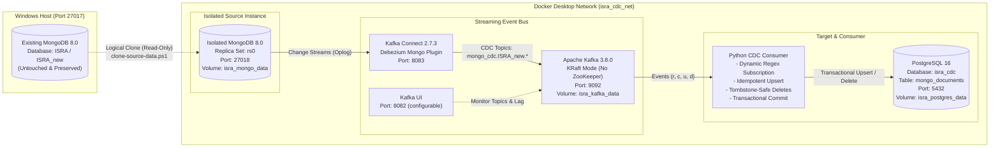

# Event-Driven CDC POC — MongoDB to PostgreSQL using Debezium and Kafka

## Architecture Overview



---

## Prerequisites and Compatible Versions

| Component | Selected Version | Role | Compatibility Rationale |
|---|---|---|---|
| **Host OS** | Windows 10/11 + Docker Desktop | Host Environment | Standard container runtime |
| **Existing Source MongoDB** | MongoDB 8.0 on Windows (Port 27017) | Production DB | Never touched, reconfigured, or mounted |
| **Isolated Source MongoDB** | `mongo:8.0` (Replica set `rs0`, Port 27018) | CDC Source Instance | Change stream compatible, single-node replica set |
| **Apache Kafka** | `apache/kafka:3.8.0` (Port 9092) | Event Streaming Broker | Native KRaft mode, eliminates ZooKeeper |
| **Debezium Connect** | `debezium/connect:2.7.3.Final` (Port 8083) | Change Data Capture Engine | Official MongoDB connector plugin pre-installed |
| **Kafka UI** | `provectuslabs/kafka-ui:latest` (Port 8082) | Observability UI | Real-time topic inspection, consumer lag monitoring |
| **PostgreSQL Target** | `postgres:16-alpine` (Port 5432) | Target Database | Native JSONB storage and GIN indexing |
| **Python Consumer** | Python 3.11 (`confluent-kafka`, `psycopg2`) | Standalone CDC Consumer | High-throughput, manual offset commit, graceful shutdown |

---

## Project Directory Structure

```text
C:\CDC-Mongo-Postgres-POC\
├── docker-compose.yml              # Complete multi-container service stack & volumes
├── .env.example                    # Template environment configuration
├── .env                            # Active environment file (auto-generated)
├── .gitignore                      # Git ignore rules
├── README.md                       # Comprehensive POC guide & operations documentation
├── start.ps1                       # Automated 1-click startup, replica set init, connector setup
├── stop.ps1                        # Graceful container stop (preserves persistent volumes)
├── verify.ps1                      # Diagnostic health check across all services
├── mongodb\
│   └── init-replica-set.js        # Script to initiate single-node replica set rs0
├── debezium\
│   └── register-connector.json    # Debezium MongoDB connector configuration definition
├── consumer\
│   ├── Dockerfile                  # Consumer container definition
│   ├── requirements.txt            # Python dependencies (confluent-kafka, psycopg2-binary)
│   ├── main.py                     # Resilient CDC consumer loop with transactional commits
│   ├── config.py                   # Consumer environment variable configuration loader
│   └── README.md                   # Dedicated consumer documentation
├── postgres\
│   └── init.sql                    # Initial target schema (mongo_documents table & indexes)
├── scripts\
│   ├── clone-source-data.ps1       # Safe logical clone with disk space verification
│   ├── clone_helper.py             # Python BSON-preserving data transfer utility
│   ├── register-connector.ps1      # Kafka Connect REST API registration & health polling
│   ├── test-cdc.ps1                # Automated end-to-end verification script
│   └── cdc_test_runner.py          # Python E2E test driver (inserts, updates, deletes)
└── logs\                           # Persistent consumer logs directory
```

---

## Setup and Startup Instructions

### 1. Initial Launch
Open PowerShell and navigate to the project directory:
```powershell
cd C:\CDC-Mongo-Postgres-POC
.\start.ps1
```

The script automatically executes the following:
1. Validates Docker Desktop status (Linux container mode).
2. Verifies or generates `.env` from `.env.example`.
3. Launches all 6 Docker Compose services (`mongo-source`, `kafka`, `kafka-connect`, `kafka-ui`, `postgres`, `cdc-consumer`).
4. Waits for health checks to report `Healthy`.
5. Initiates MongoDB replica set `rs0` on port 27017 inside the container.
6. Verifies the Debezium connector plugin and registers `isra-mongodb-connector`.
7. Displays all active service URLs.

### 2. Service Endpoints
| Service | Endpoint | Purpose |
|---|---|---|
| **Kafka UI** | `http://localhost:8082` | Topic inspection, message payloads, consumer group lag |
| **Kafka Connect REST API** | `http://localhost:8083` | Connector lifecycle management and status queries |
| **Kafka Broker** | `localhost:9092` | External Kafka listener for host tools |
| **Isolated MongoDB** | `localhost:27018` | Replica set `rs0` (`?directConnection=true` from host) |
| **Target PostgreSQL** | `localhost:5432` | Database `isra_cdc`, Table `mongo_documents` |

---

## Source-Data Cloning & Storage Safeguards

### Safety Principles
- **No Direct Mounts**: The existing MongoDB data directory (`C:\Program Files\MongoDB\Server\8.0\data`) is **NEVER** mounted into Docker.
- **Read-Only Inspection**: Source database `localhost:27017` is read using standard query cursors and is never modified.
- **Disk Space Verification**: The script checks free storage on Drive `C:` before performing any clone.
- **BSON Type Preservation**: BSON types (`ObjectId`, `ISODate`, `Binary`, embedded dicts) are preserved without truncation.

### Cloning Commands

```powershell
# 1. Interactive inspection and prompt before clone (default):
.\scripts\clone-source-data.ps1 -SourceDb ISRA -TargetDb ISRA_new

# 2. Fast POC sampling (clones up to 10 documents per collection):
.\scripts\clone-source-data.ps1 -SourceDb ISRA -TargetDb ISRA_new -SampleLimit 10 -Force

# 3. Specific business collections:
.\scripts\clone-source-data.ps1 -SourceDb ISRA -TargetDb ISRA_new -Collections "Radio_masterradioproject,Radio_priority" -SampleLimit 50 -Force
```

---

## Debezium Connector Configuration & Inspection

### Registration
The connector configuration resides in `debezium/register-connector.json`.
To register or update:
```powershell
.\scripts\register-connector.ps1 -Force
```

### Connector Details
- **Connector Name**: `isra-mongodb-connector`
- **Topic Prefix**: `mongo_cdc`
- **Database Include**: `ISRA_new`
- **Capture Mode**: `change_streams_update_full` (ensures full document is present in update events)
- **Snapshot Mode**: `initial` (captures all existing records, then transitions seamlessly to live change streams)

### Check Status via REST API
```powershell
Invoke-RestMethod -Uri "http://localhost:8083/connectors/isra-mongodb-connector/status" | ConvertTo-Json -Depth 4
```

Expected Response:
```json
{
  "name": "isra-mongodb-connector",
  "connector": {
    "state": "RUNNING",
    "worker_id": "172.19.0.5:8083"
  },
  "tasks": [
    {
      "id": 0,
      "state": "RUNNING",
      "worker_id": "172.19.0.5:8083"
    }
  ],
  "type": "source"
}
```

---

## Kafka Topics and Message Inspection

### Topic Naming Convention
Debezium publishes events following this convention:
`mongo_cdc.ISRA_new.<collection_name>`

### Web UI
Navigate to [http://localhost:8082](http://localhost:8082):
1. Go to **Topics** -> Click on any `mongo_cdc.ISRA_new.*` topic.
2. Go to **Messages** to view BSON Extended JSON payloads.
3. Go to **Consumers** to monitor consumer lag on `isra-cdc-consumer-group`.

---

## PostgreSQL Target Schema & Queries

Target Database: `isra_cdc`

```sql
CREATE TABLE IF NOT EXISTS mongo_documents (
    source_database TEXT NOT NULL,
    collection_name TEXT NOT NULL,
    document_id TEXT NOT NULL,
    document JSONB,
    last_operation TEXT,
    source_timestamp TIMESTAMPTZ,
    updated_at TIMESTAMPTZ NOT NULL DEFAULT NOW(),
    PRIMARY KEY (source_database, collection_name, document_id)
);

CREATE INDEX IF NOT EXISTS idx_mongo_documents_lookup ON mongo_documents(source_database, collection_name);
CREATE INDEX IF NOT EXISTS idx_mongo_documents_updated ON mongo_documents(updated_at);
CREATE INDEX IF NOT EXISTS idx_mongo_documents_gin ON mongo_documents USING GIN (document);
```

### Querying PostgreSQL
```powershell
docker exec -it isra-postgres psql -U postgres -d isra_cdc
```

Sample SQL queries:
```sql
-- 1. Check synchronized collections and document counts
SELECT source_database, collection_name, COUNT(*), MAX(updated_at)
FROM mongo_documents
GROUP BY source_database, collection_name;

-- 2. Query fields from JSONB documents
SELECT document_id, document->>'Project_Name' as project, last_operation, updated_at
FROM mongo_documents
WHERE collection_name = 'Radio_masterradioproject';

-- 3. Query documents using JSONB containment
SELECT document_id, document
FROM mongo_documents
WHERE document @> '{"Demo": "Final"}';
```

---

## End-to-End Automated Verification Test

Run the complete pipeline verification:
```powershell
.\scripts\test-cdc.ps1
```

### What the Test Verifies:
1. **Insert**: Creates a document in MongoDB `ISRA_new.cdc_test_pipeline` -> Verifies Debezium captures the event (`op: c`) -> Verifies Python consumer writes the record to PostgreSQL `mongo_documents`.
2. **Update**: Modifies the document in MongoDB (`version: 2`, `status: UPDATED_STATE_VERIFIED`) -> Verifies Debezium captures update (`op: u`) -> Verifies PostgreSQL row is updated.
3. **Delete**: Deletes the document in MongoDB -> Verifies Debezium captures delete (`op: d`) -> Verifies the document row is cleanly deleted from PostgreSQL.

Both snapshot reads (`op: r`) and live change events (`op: c, u, d`) are supported.

---

## Troubleshooting Guide

### 1. Port 8080 Conflict
If port 8080 is used by Windows services (`blservice`, IIS, etc.), Kafka UI is configured on port `8082` in `.env` (`KAFKA_UI_HOST_PORT=8082`). To change the port, update `KAFKA_UI_HOST_PORT` in `.env`.

### 2. Host MongoDB Driver Connection to Isolated MongoDB
When connecting from host Python or tools to `localhost:27018`:
Always include `?directConnection=true`:
```python
client = pymongo.MongoClient("mongodb://localhost:27018/?directConnection=true")
```
This prevents driver replica set topology discovery from attempting to resolve the container internal hostname `mongo-source:27017`.

### 3. Debezium Connector Unassigned or Failed
Check Kafka Connect logs:
```powershell
docker compose logs kafka-connect --tail 50
```
To restart or re-register the connector:
```powershell
.\scripts\register-connector.ps1 -Force
```

### 4. Consumer Log Inspection
```powershell
docker compose logs -f cdc-consumer
```
Persistent logs are written to `logs/consumer.log`.

---

## Stopping and Restarting Without Data Loss

### Stop POC
```powershell
.\stop.ps1
```
This runs `docker compose down` without `-v`. Named Docker volumes (`isra_mongo_data`, `isra_kafka_data`, `isra_postgres_data`) are preserved.

### Resume POC
```powershell
.\start.ps1
```
All data and connector offset bookmarks are preserved, and processing resumes from where it stopped.

---

## Known Limitations & Production Readiness Next Steps

1. **Dead Letter Queue (DLQ)**: For production pipelines, configure Kafka DLQ topics to capture unparseable messages without stalling the consumer partition.
2. **PostgreSQL Target Tables**: The POC preserves arbitrary BSON documents as `JSONB` in a single table `mongo_documents`. In production, collections can either be mapped into dedicated typed tables or extracted via dbt/PostgreSQL views.
3. **High Availability**:
   - Multi-broker Kafka cluster with `replication.factor >= 3`.
   - Multi-node MongoDB replica set across independent availability zones.
   - Distributed Kafka Connect cluster with multiple workers.
4. **Consumer Scaling**: Increase partition count on Kafka topics to allow multiple parallel Python consumer instances in consumer group `isra-cdc-consumer-group`.
